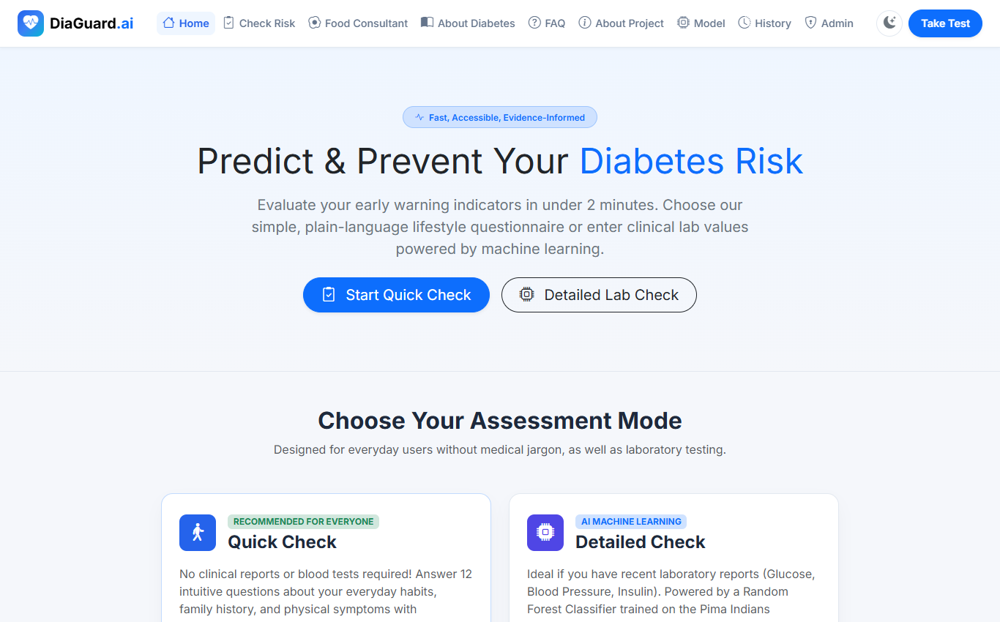
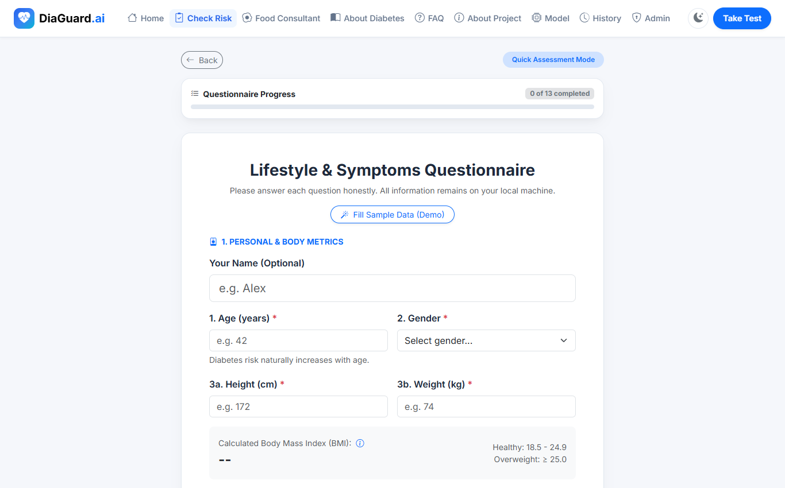
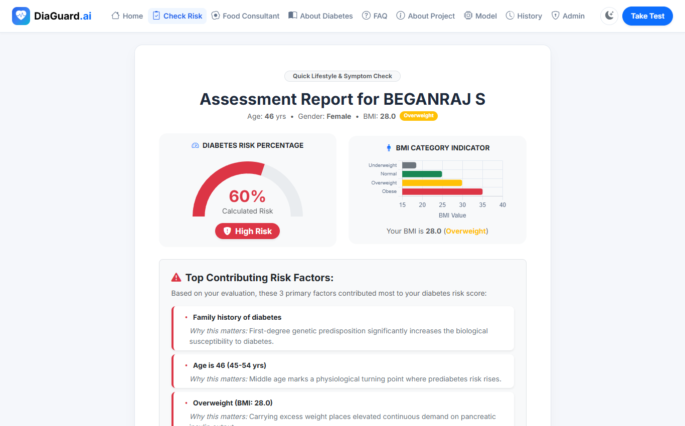
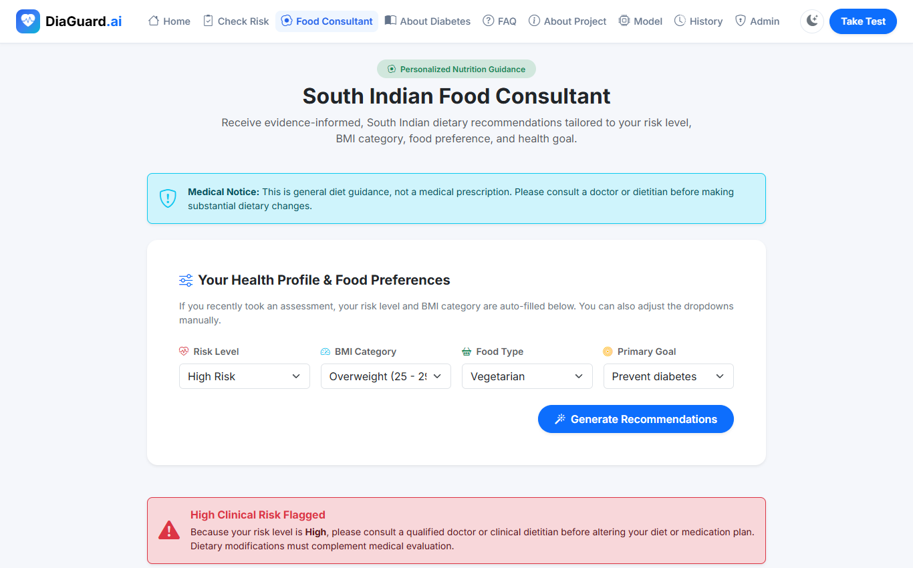

# DiaGuard.ai - Diabetes Risk Prediction System

[](https://www.python.org/)
[](https://flask.palletsprojects.com/)
[](https://scikit-learn.org/)
[](LICENSE)

**DiaGuard.ai** is an intelligent, dual-track diabetes screening and health-informatics web application. It empowers users to evaluate their risk of Type 2 Diabetes through either an accessible 12-question lifestyle screener (Quick Check) or a clinical laboratory marker machine learning model (Detailed Check). The system couples predictive analytics with explainable AI (XAI) risk drivers, an automated clinical PDF report generator, dynamic longitudinal tracking, and a 4-dimensional South Indian Food Consultant delivering personalized nutrition plans in both English and Tamil.

---

## 🖼️ Application Screenshots

### 1. Home Landing Page


### 2. Lifestyle Risk Assessment (Quick Check)


### 3. Risk Stratification & Top Contributing Drivers


### 4. South Indian Food Consultant


---

## ✨ Key Features

1. **Dual-Track Risk Assessment**:
   - **Quick Check (`/quick-check`)**: 12 evidence-informed lifestyle questions covering age, BMI, family history, symptoms (polyuria, polydipsia, fatigue), physical activity, and hypertension.
   - **Detailed Check (`/detailed-check`)**: Clinical evaluation for patients with laboratory data (Pregnancies, Glucose, Blood Pressure, Skin Thickness, Insulin, BMI, Diabetes Pedigree Function, Age) powered by a trained Decision Tree classifier.
2. **Explainable AI (Top 3 Risk Drivers)**:
   - Analyzes user responses against weighted clinical metrics to highlight the top 3 primary risk contributors with plain-language physiological rationales.
3. **Multi-Model Benchmark & Selection (`/about-model`)**:
   - Compares **Logistic Regression**, **Decision Tree**, and **Random Forest** algorithms on the Pima Indians Diabetes Dataset using stratified 80/20 train-test splits and median zero-imputation.
   - Real-time confusion matrix display (TN, FP, FN, TP) and metric evaluation (Accuracy, Precision, Recall).
4. **Interactive Visualizations (Chart.js)**:
   - Half-doughnut risk percentage gauge with dynamic color thresholds.
   - Comparative BMI benchmark bar chart.
   - Longitudinal risk progression trend line on the History page.
   - Administrative risk category distribution charts.
5. **South Indian Food Consultant (`/food-consultant`)**:
   - 4-dimensional personalization matrix matching **Risk Level** (Low/Medium/High), **BMI Category** (Underweight/Normal/Overweight/Obese), **Dietary Preference** (Vegetarian/Non-Vegetarian/Eggetarian/Vegan), and **Health Goal** (Prevent Diabetes/Control Diabetes/Lose Weight).
   - Generates tailored daily meal schedules, low-GI whole grain recommendations, and foods to limit/avoid.
6. **Bilingual 7-Day Diet & Exercise Plans**:
   - One-click language switch between **English** and **Tamil (தமிழ்)** for structured weekly meal plans and physical activity schedules.
7. **Automated Clinical PDF Report (`/download-report`)**:
   - Programmatic on-demand generation of clinical summary reports via **ReportLab**, including patient vitals, risk tier, contributing drivers, lifestyle tips, and legal disclaimers.
8. **Longitudinal History & Local Storage (`/history`)**:
   - Persistent SQLite storage (`assessments.db`) tracking prior screenings and chronological risk trends.
9. **Role-Based Admin Analytics Dashboard (`/admin`)**:
   - Protected via session authentication (`@admin_required`).
   - Displays aggregate metrics: total screenings, risk distribution counts, average cohort BMI, average risk percentage, and recent audit logs.
10. **Modern UI & Dark/Light Mode**:
    - Built on **Bootstrap 5.3** with persistent dark/light theme switching and head-level anti-flash scripting.

---

## 🛠️ Technology Stack

- **Backend Runtime**: Python 3.8+
- **Web Framework**: Flask 2.2+ (WSGI routing, session cookies, Jinja2 templating)
- **Machine Learning & Data Processing**:
  - `scikit-learn` (StandardScaler, DecisionTreeClassifier, RandomForestClassifier, LogisticRegression)
  - `pandas` (Dataset cleaning, median zero-value imputation)
  - `numpy` (Vectorized numerical operations)
  - `joblib` (Model bundle serialization)
- **Reporting Engine**: `ReportLab` (Automated PDF compilation)
- **Database**: SQLite3 (Embedded relational storage)
- **Front-end**:
  - HTML5 & CSS3 with CSS variables
  - JavaScript (Vanilla ES6+ for live BMI calculation and DOM events)
  - Bootstrap 5.3 (Responsive layout and components)
  - Chart.js 4.x (Interactive canvas charts and gauges)
- **Testing**: `pytest` (33 unit and integration test cases)

---

## 📁 Folder Structure

```text
diabetes-risk-prediction/
│
├── app.py                     # Flask application router, scoring engine, auth & DB logic
├── food_consultant.py         # Rule-based Food Consultant engine
├── food_consultant_data.json  # South Indian nutrition classification & meal plan data
├── plans_data.py              # Bilingual (English/Tamil) 7-day diet & exercise dictionaries
├── report_generator.py        # ReportLab programmatic PDF report generator
├── requirements.txt           # Python package dependencies
├── .env.example               # Template for environment configuration
├── .gitignore                 # Files and directories excluded from version control
├── README.md                  # Comprehensive project documentation
├── VIVA_NOTES.md              # Technical viva and architecture guide
│
├── model/
│   ├── diabetes.csv           # Pima Indians Diabetes Dataset
│   ├── train_model.py         # Data preprocessing, 3-model benchmark & export pipeline
│   └── model.pkl              # Serialized trained model bundle (Classifier + Scaler)
│
├── static/
│   ├── css/
│   │   └── style.css          # Custom styling, responsive cards & theme variables
│   └── js/
│       └── script.js          # Live BMI calculator, form validation & theme handler
│
├── templates/
│   ├── base.html              # Core layout template with navbar, theme toggle & footer
│   ├── index.html             # Landing page with screening track selector
│   ├── questionnaire.html     # 12-question lifestyle screener with live BMI calculator
│   ├── detailed_check.html    # Clinical lab markers ML prediction form
│   ├── result.html            # Assessment result page with gauge, top drivers & action plan
│   ├── food_consultant.html   # South Indian nutrition consultation interface
│   ├── history.html           # Historical assessments table & trend chart
│   ├── about_model.html       # ML algorithm comparison table & confusion matrices
│   ├── about_diabetes.html    # Educational guide on diabetes types and prevention
│   ├── about_project.html     # Project architecture and technical specification
│   ├── faq.html               # Frequently asked questions accordion
│   ├── admin_login.html       # Admin authentication interface
│   ├── admin.html             # Admin analytics dashboard
│   ├── 404.html               # Custom 404 Not Found error page
│   └── 500.html               # Custom 500 Server Error page
│
└── docs/
    ├── diagrams/              # System architecture, UML, DFD & workflow diagrams
    ├── screenshots/           # Application screenshots for documentation
    └── test_project.py        # Automated test suite (33 test cases)
```

---

## 🚀 Setup & Installation

### 1. Prerequisites
- Python 3.8 or higher installed on your system.
- Git installed.

### 2. Clone the Repository
```bash
git clone https://github.com/beganraj/diaguard-ai.git
cd diaguard-ai
```

### 3. Create and Activate a Virtual Environment
- **On Windows (PowerShell)**:
  ```powershell
  python -m venv venv
  .\venv\Scripts\Activate.ps1
  ```
- **On Linux / macOS**:
  ```bash
  python3 -m venv venv
  source venv/bin/activate
  ```

### 4. Install Dependencies
```bash
pip install -r requirements.txt
```

### 5. Configure Environment Variables
Copy `.env.example` to `.env` (optional for local demo; safe defaults are provided):
```bash
cp .env.example .env
```
Environment variables:
- `SECRET_KEY` / `FLASK_SECRET_KEY`: Cryptographic signing key for session cookies (defaults to a local development key).
- `ADMIN_USERNAME`: Administrator username for the `/admin` portal (default: `admin`).
- `ADMIN_PASSWORD`: Administrator password for the `/admin` portal (default: `admin123`).

### 6. Train the Machine Learning Model
The pre-trained model bundle (`model/model.pkl`) is included in the repository. To re-train the models, evaluate benchmarks, and generate a fresh bundle:
```bash
python model/train_model.py
```

### 7. Run the Application
```bash
python app.py
```
Open your web browser and navigate to:
**`http://127.0.0.1:5000`**

### 8. Admin Portal Credentials
To access the administrative dashboard at `http://127.0.0.1:5000/admin`:
- **Default Username**: `admin`
- **Default Password**: `admin123`
*(Both values can be overridden via `ADMIN_USERNAME` and `ADMIN_PASSWORD` in your `.env` file).*

---

## 🧪 Running Automated Tests

To run the complete automated test suite (33 unit and route integration tests):
```bash
python -m pytest docs/test_project.py -v
```

---

## ⚖️ Disclaimer

**This is not a medical diagnosis. Please consult a doctor.**

DiaGuard.ai is developed exclusively for informational, educational, and early risk-screening purposes. The predictions, scores, and nutrition plans generated by this tool do not constitute clinical diagnoses or formal medical advice. Users exhibiting persistent symptoms or categorized as having moderate-to-high risk should promptly consult a licensed healthcare professional or diabetologist.
